# om10mi-mods

Extra firmware features for the **Olympus OM-D E-M10 Mark I**: new film looks, colour editors, and a video
recording limit of about 60 minutes.

This project is unofficial and is not affiliated with OM Digital Solutions or Olympus.

Free to use. If it saved you some time or you just like the looks, you can
[buy me a coffee on Ko-fi](https://ko-fi.com/meghnus). Donations are optional and change nothing about what
you get.

## Quick start

1. Download the release from the [Releases page](https://github.com/Meghnus/om10mi-mods/releases):
   `om10mi-build.exe` (Windows, no Python needed) or `om10mi-mods-v56.zip` (any system, needs Python 3.10+).
2. Run it: double-click `om10mi-build.exe`, or unzip and double-click `om10mi-build.bat` (Windows) or
   `om10mi-build.command` (macOS), or run `./om10mi-build.sh` (Linux).
3. Read and accept the OM Digital Solutions licence it shows. The builder downloads the official firmware 1.4
   itself; nothing from OM is stored in this repository.
4. When it asks, enter the SD card's drive letter to copy the file to the card, or copy the folder
   `out/DCOLYMP` to the card yourself.
5. Camera off, card in, **hold OK and switch on**, and wait until the AF lamp blinks rapidly
   (full steps in [INSTALL.md](INSTALL.md)).

A copy of the official firmware, for going back, is written to `out/RESTORE/DCOLYMP`. The Windows exe is
unsigned, so Windows may show a SmartScreen warning; if you prefer, use the zip and the Python launcher, which
run the same `om10mi.py`.

## What this is

This repository contains **no firmware**. It holds a builder (`om10mi.py`) and a list of edits
(`patch/looks56.json`). The builder downloads the official E-M10 Mark I v1.4 firmware from the OM Digital
Solutions server to your PC, applies the edits, checks the result byte for byte, and writes one file that is
ready to copy to an SD card. The firmware itself remains the property of OM Digital Solutions.

There is a single release: **version 56**. It already includes everything listed in the version history below.

## What version 56 contains

**Film looks**
- 14 film looks, each with its own colour matrix and tone curve.
- 4 new looks: **Portra 400**, **Kodachrome 64**, **Ektar 100**, **Gold 200**, each with its own colour. They
  appear in the Picture Mode list, the SCP menu, Live View, and RAW Data Edit Custom1/Custom2.
- Contrast, Sharpness, Highlight, Shadow and Gradation really change the picture on looks, including Eterna and
  the new looks. In the SCP menu the Contrast and Sharpness dials work on every look.
- Acros in RAW Data Edit Custom is black and white again.

**Colour editors**
- Per-sector colour editor: Hue, Saturation and Lightness for 12 colour sectors (Green, Amber, Teal, Cyan,
  Azure, Blue, Magenta, Indigo, Olive, Red, Orange, Yellow). The Sector row shows colour names instead of a dash.
- Per-look colour editor on the Custom page (Picture Mode, right key).
- Looks can be chosen in RAW Data Edit Custom1 and Custom2; each bank has its own Contrast, Sharpness,
  Saturation, Gradation and Sector/Hue/Sat/Light rows.
- Every row has its own title and caption (for example "Gradation High Key"; an unchanged row reads
  "Picture Mode", meaning it follows the Picture Mode setting) and a new icon.

**Video**
- The recording limit is raised from 29:59 to 59:50 (the recording library is set to 60 minutes). A single video
  file is still capped at 4 GB (FAT32), so at high bitrates recording can stop before 59:50.

The full guide and test list are in [docs/GUIDE-56.md](docs/GUIDE-56.md).

## Samples

Straight out of camera, no editing: an E-M10 Mark I running version 56. Each scene was shot once as RAW; the
looks below are the camera's own conversions of that RAW (RAW Data Edit). The first picture of every sheet is
the stock rendering from the same RAW (**Natural**; the Alley scene was shot in **i-Enhance** and is labelled
that way), taken from the preview JPEG the camera stores inside the RAW file, so the difference between the
stock rendering and each look is easy to see. Metadata has been removed from all pictures, and they are
resized to 1600 px on the long side.

The sample photos are (c) 2026 Meghnus, all rights reserved: viewing only, no reuse.

Looks shown, in order: Natural (camera), Eterna, Nostalgic Neg, Ektar 100, Classic Neg.

| Scene | Sheet | Individual files |
|---|---|---|
| Flowers | 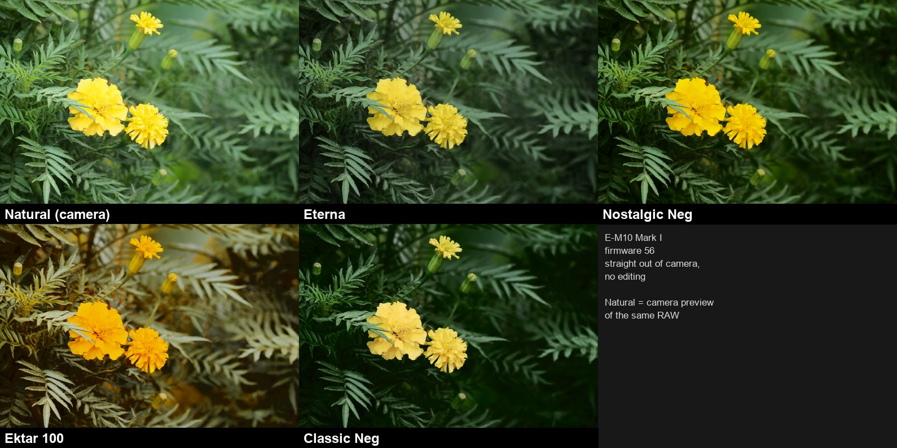 | [natural](docs/samples/flowers_natural.jpg), [eterna](docs/samples/flowers_eterna.jpg), [nostalgic neg](docs/samples/flowers_nostalgic-neg.jpg), [ektar 100](docs/samples/flowers_ektar-100.jpg), [classic neg](docs/samples/flowers_classic-neg.jpg) |
| Tower | 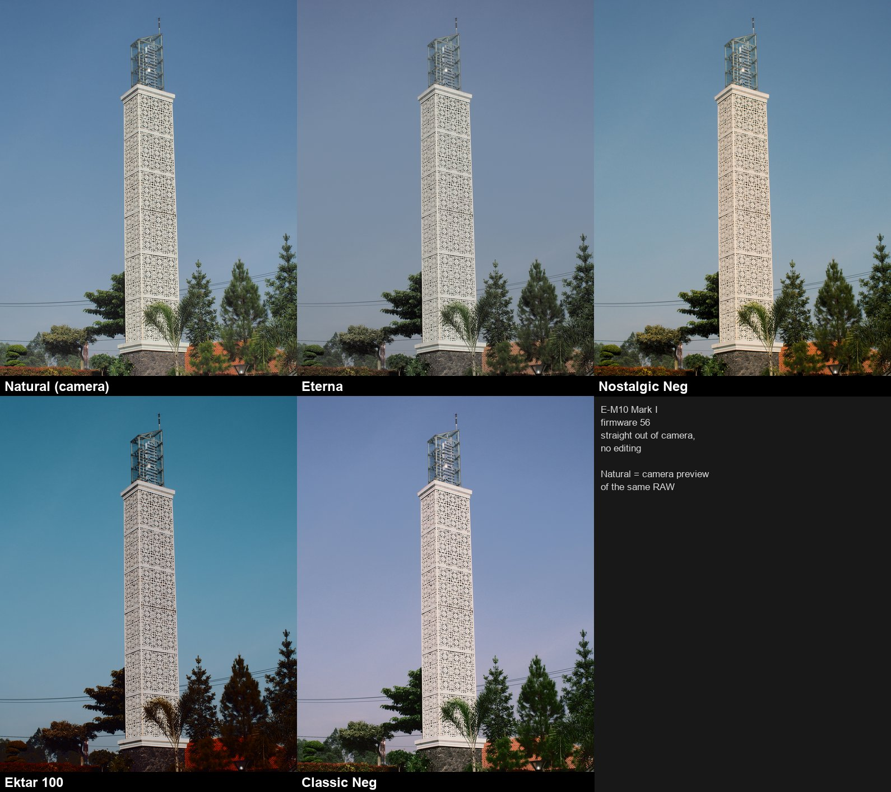 | [natural](docs/samples/tower_natural.jpg), [eterna](docs/samples/tower_eterna.jpg), [nostalgic neg](docs/samples/tower_nostalgic-neg.jpg), [ektar 100](docs/samples/tower_ektar-100.jpg), [classic neg](docs/samples/tower_classic-neg.jpg) |
| Courtyard | 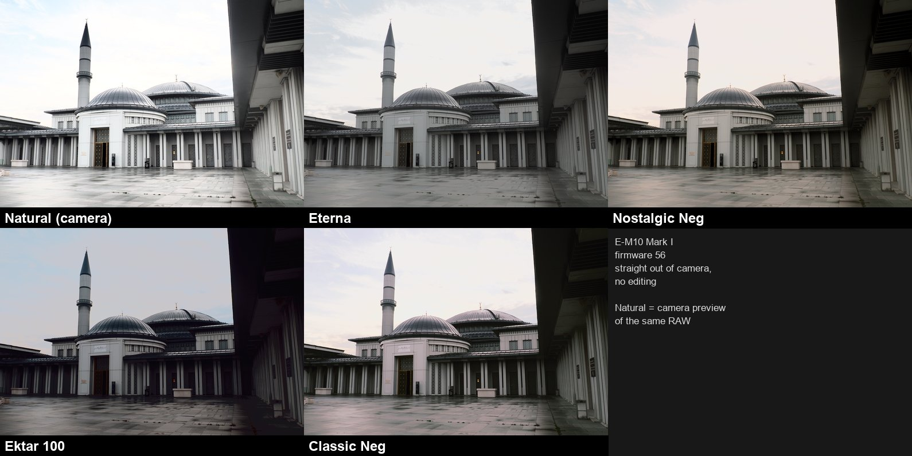 | [natural](docs/samples/mosque_natural.jpg), [eterna](docs/samples/mosque_eterna.jpg), [nostalgic neg](docs/samples/mosque_nostalgic-neg.jpg), [ektar 100](docs/samples/mosque_ektar-100.jpg), [classic neg](docs/samples/mosque_classic-neg.jpg) |
| Wall | 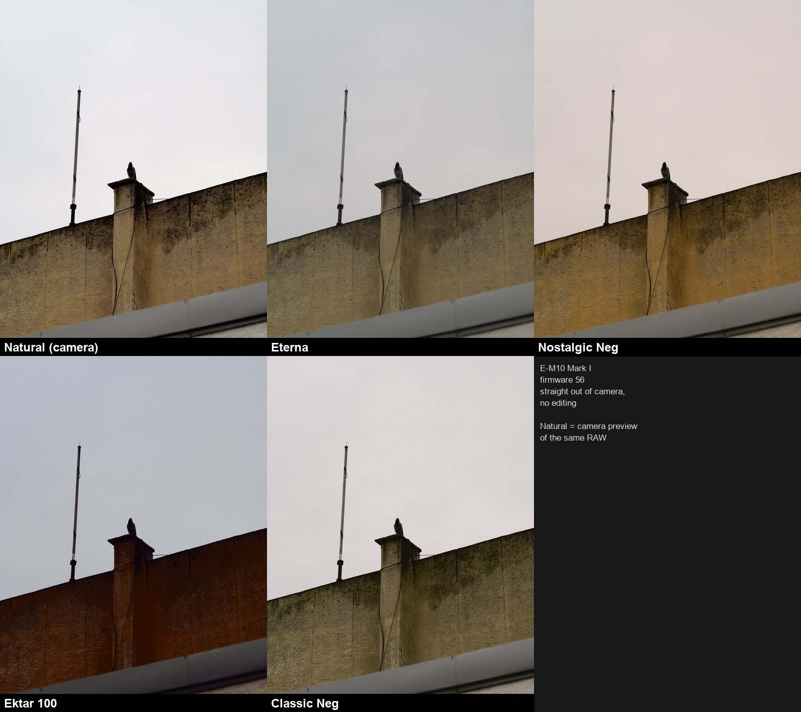 | [natural](docs/samples/wall_natural.jpg), [eterna](docs/samples/wall_eterna.jpg), [nostalgic neg](docs/samples/wall_nostalgic-neg.jpg), [ektar 100](docs/samples/wall_ektar-100.jpg), [classic neg](docs/samples/wall_classic-neg.jpg) |
| Gate | 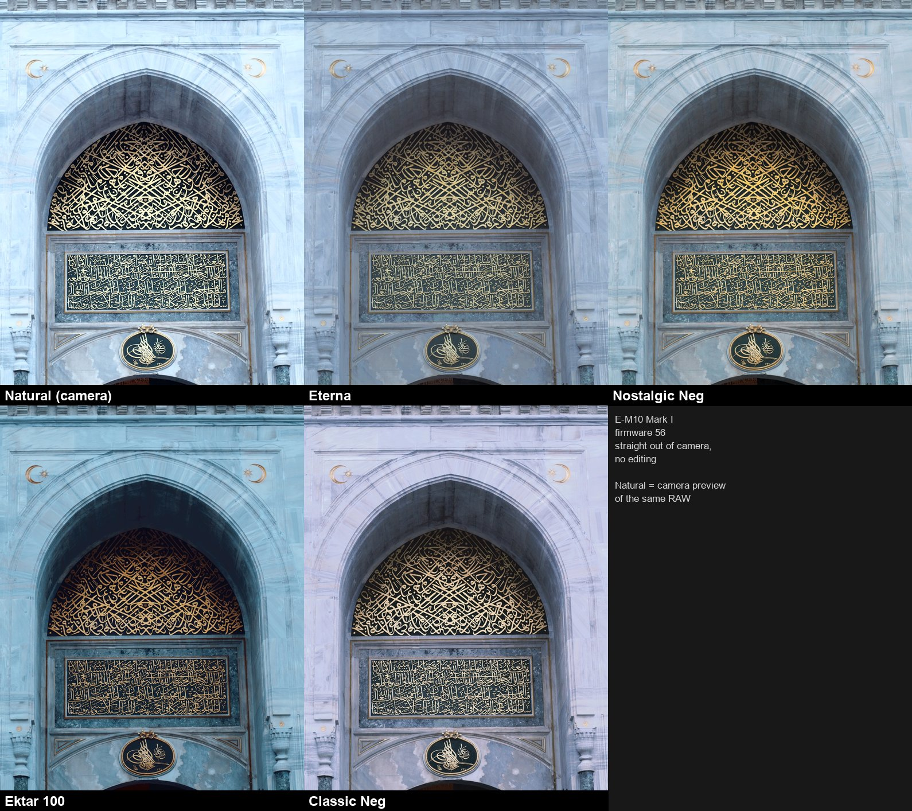 | [natural](docs/samples/gate_natural.jpg), [eterna](docs/samples/gate_eterna.jpg), [nostalgic neg](docs/samples/gate_nostalgic-neg.jpg), [ektar 100](docs/samples/gate_ektar-100.jpg), [classic neg](docs/samples/gate_classic-neg.jpg) |
| Bridge | 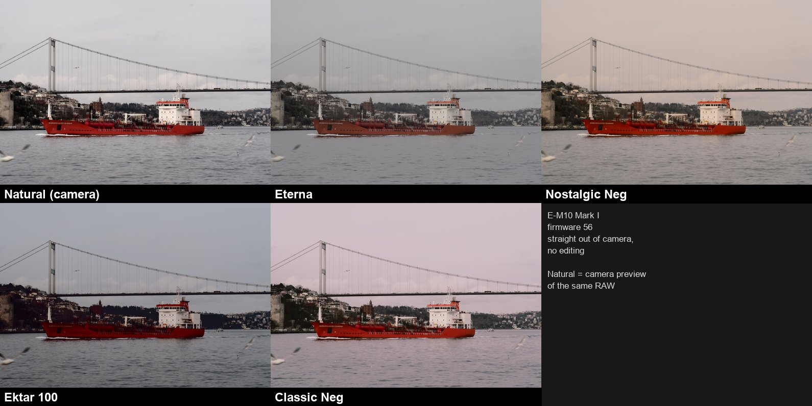 | [natural](docs/samples/bridge_natural.jpg), [eterna](docs/samples/bridge_eterna.jpg), [nostalgic neg](docs/samples/bridge_nostalgic-neg.jpg), [ektar 100](docs/samples/bridge_ektar-100.jpg), [classic neg](docs/samples/bridge_classic-neg.jpg) |
| Minaret | 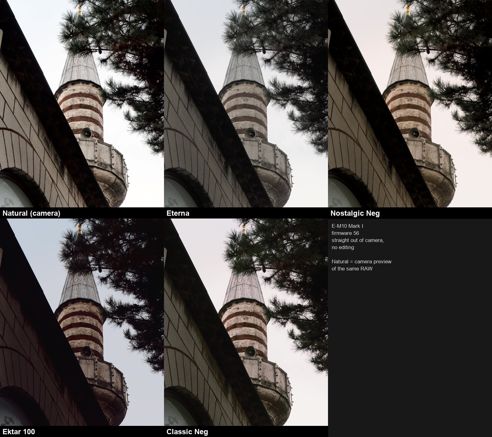 | [natural](docs/samples/minaret_natural.jpg), [eterna](docs/samples/minaret_eterna.jpg), [nostalgic neg](docs/samples/minaret_nostalgic-neg.jpg), [ektar 100](docs/samples/minaret_ektar-100.jpg), [classic neg](docs/samples/minaret_classic-neg.jpg) |
| Street | 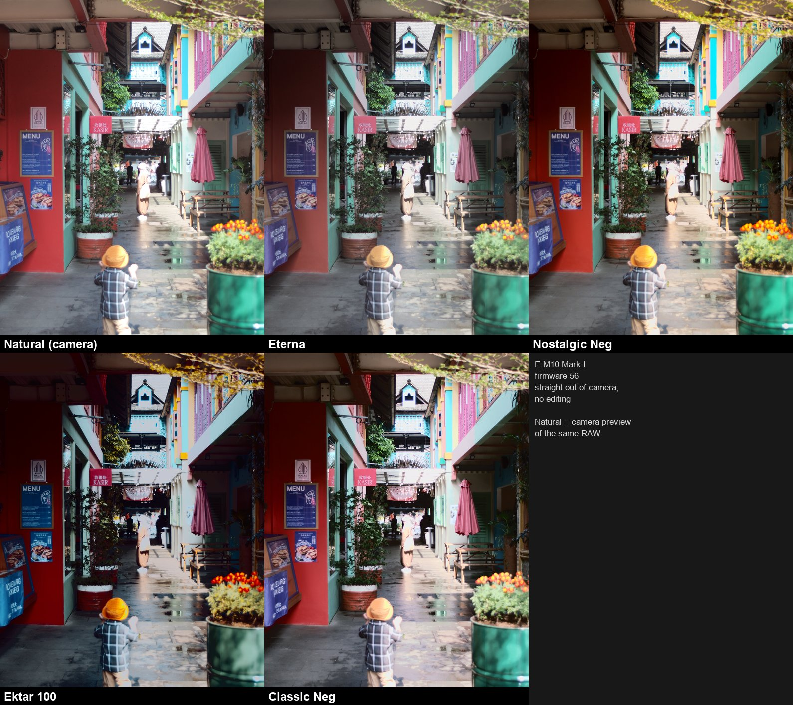 | [natural](docs/samples/street_natural.jpg), [eterna](docs/samples/street_eterna.jpg), [nostalgic neg](docs/samples/street_nostalgic-neg.jpg), [ektar 100](docs/samples/street_ektar-100.jpg), [classic neg](docs/samples/street_classic-neg.jpg) |
| Alley | 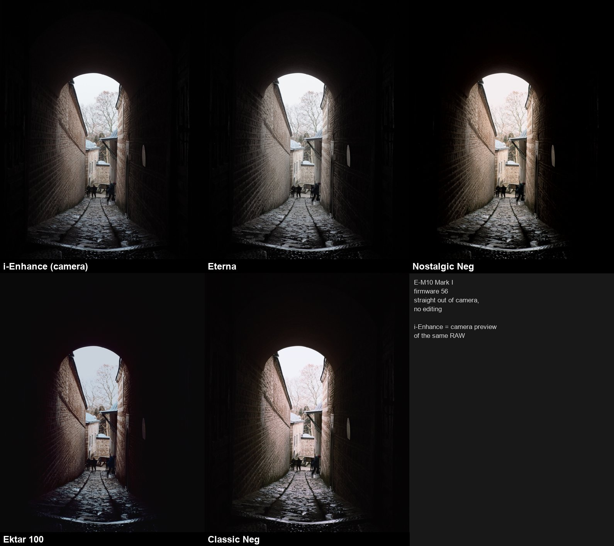 | [i-enhance](docs/samples/alley_i-enhance.jpg), [eterna](docs/samples/alley_eterna.jpg), [nostalgic neg](docs/samples/alley_nostalgic-neg.jpg), [ektar 100](docs/samples/alley_ektar-100.jpg), [classic neg](docs/samples/alley_classic-neg.jpg) |
| Station | 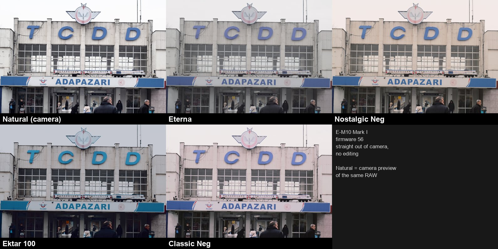 | [natural](docs/samples/station_natural.jpg), [eterna](docs/samples/station_eterna.jpg), [nostalgic neg](docs/samples/station_nostalgic-neg.jpg), [ektar 100](docs/samples/station_ektar-100.jpg), [classic neg](docs/samples/station_classic-neg.jpg) |
| Square | 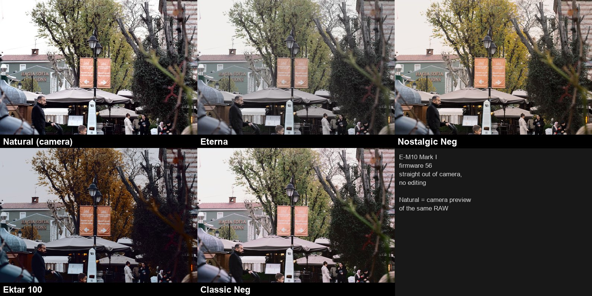 | [natural](docs/samples/square_natural.jpg), [eterna](docs/samples/square_eterna.jpg), [nostalgic neg](docs/samples/square_nostalgic-neg.jpg), [ektar 100](docs/samples/square_ektar-100.jpg), [classic neg](docs/samples/square_classic-neg.jpg) |

These are only a handful of looks; the others (for example Portra 400, Kodachrome 64 and Gold 200) are not
shown yet.

## Warnings

- **No warranty.** Installing custom firmware is always risky; the camera may stop working properly. You accept
  all of the risk (see Apache-2.0 sections 7 and 8, and CC BY-NC-SA 4.0 section 5).
- For the **E-M10 Mark I (code E113) with firmware v1.4** only. Do not install it on any other model. The builder
  refuses files that are not the intended firmware.
- Made and tested on a single camera body belonging to the author. It has never been tried on any other body.
- Update mode (hold OK while switching on) does not run any of the added code, so you can always reinstall the
  official firmware from `out/RESTORE`. Have that file ready, and a full battery, before you start.
- The licence that the OM Digital Solutions server attaches to the download (shown by the builder; you must
  accept it before anything is downloaded) prohibits, among other things, modifying or reverse engineering the
  software. Building and installing this file is your own decision and responsibility. Read that licence.
- Do not share the built BIN file or the official firmware; this repository deliberately includes neither.

## Known limitations

The four new looks borrow the icon of an existing look: Portra 400 = Pro Neg Std, Kodachrome 64 = Classic
Chrome, Ektar 100 = Velvia, Gold 200 = Nostalgic Neg. The names are shown correctly; own icons are planned for a
later version.

## Version history

Only milestones that were tried on a camera. The builder produces **only version 56**, which contains all
earlier content; older versions are not offered.

| Version | Main content | Test status |
|---|---|---|
| 37 | 14 film looks with their own colour matrix and tone curve | Audited; installed on the owner's camera and the base of every later version |
| 40 | 37 + video recording limit raised to about 60 minutes (59:50) | Installed and used on the camera; recording beyond 30 minutes not yet confirmed |
| 46 | Per-sector colour editor (Hue/Saturation/Lightness) | Field test passed: the editor shows and the effect is visible in photos |
| 48 | Per-look colour editor on the Custom page | Field test passed |
| 51 | Looks selectable in RAW Data Edit Custom1/Custom2 | Field test passed |
| **56** | 51 + 4 new looks (Portra 400, Kodachrome 64, Ektar 100, Gold 200); per-bank Contrast/Sharpness/Saturation/Gradation and Sector/Hue/Sat/Light in RAW Data Edit; Highlight/Shadow/Contrast/Gradation work on looks; colour-named Sector; row titles; new icons; SCP Contrast/Sharpness on looks; Acros fix | Two independent audits passed; owner's field test: works well. **This is what the builder makes.** |
| 57 | Colour wheel (below) | Coming soon; first test build ready |

## In development (version 57)

A colour wheel on the Color Creator screen, like the PEN-F:
- the dial picks a colour sector, and several sectors can be selected at once;
- Hue, Saturation and Lightness of the selected sectors are adjusted on the same screen, with a live preview;
- the recipe is saved per Custom1 and Custom2, and is also applied to normal photos in Color Creator mode.

Status: first test build ready, about to be tried on the camera. No release date and no files yet.

## Planned

**Import of a LUT/.cube file into a look slot of your choice.** A PC tool turns your .cube file into an
approximate camera look (colour matrix plus tone curve). The camera has no 3D-LUT stage, so this is an
approximation: close for gentle film-style LUTs, weaker for extreme ones. You pick which look slot it replaces,
preview the result by camera simulation on the PC first, then receive a new firmware file to install. Planned
after the colour wheel.

## Credits

No code or LUT files from the projects below are included; only fitted numbers (matrices and curves) that we
computed ourselves. Licences and details are in [NOTICE](NOTICE).

- **cakelesscoder/caduceus-ep7** (Apache-2.0): firmware mods for the E-P7; design reference for the look editor,
  HSL handling and the ends of the tone curve. https://github.com/cakelesscoder/caduceus-ep7
- **TingfengLuo/Camera-Profile-for-Fujifilm-Film-Simulation** and **abpy/FujifilmCameraProfiles**: Fujifilm
  film-simulation profiles used as colour targets for the Fuji-style looks.
- **spektrafilm** (Andrea Volpato) through the LUTs bundled with **RapidRAW** (CyberTimon): reference for
  Portra 400, Ektar 100 and Gold 200 (LUTs CC BY-SA 4.0, with a request not to resell them).
- **HaldCLUT / RawTherapee Film Simulation Collection** (Pat David, Pavlov Dmitry, Michael Ezra; CC BY-SA 4.0):
  reference for Kodachrome 64.
- **Spectral Film LUT** (Jan Lohse, MIT): a second film model used as a cross-check.
- **Fuji X Weekly**: the list of most popular recipes, used to choose which looks to add.
- **CUBE-to-XMP** (MIT): reference for reading LUT tables stored in XMP files.
- **Jonathan Schwarzenböck (lightsnowdev.com)**: documented flashing the E-M10 from a memory card.
- An anonymous community modder who published the E-M5 Mark II video-limit patch (the idea for the recording
  limit).
- **GNU binutils** (MN10300 opcodes) and **Linux arch/mn10300**: CPU documentation for reading the camera code.

Olympus, OM System, OM-D and the film names (Portra, Kodachrome, Ektar, Gold, Fujifilm and others) are
trademarks of their owners and are used only to identify things.

## Licences

Two licences, by kind of content:

| Part | Licence |
|---|---|
| Code `om10mi.py` and documentation (README, INSTALL, guide) | Apache License 2.0, see [LICENSE](LICENSE) |
| Data: `patch/looks56.json` and any other look data | Creative Commons BY-NC-SA 4.0 (attribution, non-commercial, share-alike), see [LICENSE-DATA](LICENSE-DATA) |
| Sample pictures in `docs/samples` | (c) 2026 Meghnus. All rights reserved: viewing only, no reuse. See [docs/samples/README.md](docs/samples/README.md) |

The look data consists of numbers fitted to the references credited above and in [NOTICE](NOTICE), which is why
it carries a non-commercial licence with attribution to all of them. None of the licences covers the OM Digital
Solutions firmware.
