# om10mi-mods

**Guides:** [Install](INSTALL.md) · [Color Wheel](docs/GUIDE-COLOR-WHEEL.md) · [Look pack builder](looktool/README.md) · [Development](docs/DEVELOPMENT.md)

Extra firmware features for the **Olympus OM-D E-M10 Mark I**: film looks, colour editors, a PEN-F-style colour
wheel, and a video recording limit of about 60 minutes.

This project is unofficial and is not affiliated with OM Digital Solutions or Olympus.

Free to use. If it saved you some time or you just like the looks, you can
[buy me a coffee on Ko-fi](https://ko-fi.com/meghnus). Donations are optional and change nothing about what
you get.

## Quick start

1. Download the release from the [Releases page](https://github.com/Meghnus/om10mi-mods/releases):
   `om10mi-build.exe` (Windows, no Python needed) or `om10mi-mods-v94.zip` (any system, needs Python 3.10+).
2. Run it: double-click `om10mi-build.exe`, or unzip and double-click `om10mi-build.bat` (Windows) or
   `om10mi-build.command` (macOS), or run `./om10mi-build.sh` (Linux).
3. Read and accept the OM Digital Solutions licence it shows. The builder downloads the official firmware 1.4
   itself; nothing from OM is stored in this repository.
4. When it asks, enter the SD card's drive letter to copy the file to the card, or copy the folder
   `out/DCOLYMP` to the card yourself.
5. Camera off, card in, **hold OK and switch on**, and wait until the AF lamp blinks rapidly
   (full steps in [INSTALL.md](INSTALL.md)).

A copy of the official firmware, for going back, is written to `out/RESTORE/DCOLYMP`. The Windows exe is
unsigned, so Windows may show a SmartScreen warning; if you prefer, use the zip and the Python launcher, which
run the same `om10mi.py`.

## What this is

This repository contains **no firmware**. It holds a builder (`om10mi.py`) and a list of edits
(`patch/*.json`). The builder downloads the official E-M10 Mark I v1.4 firmware from the OM Digital Solutions
server to your PC, applies the edits, checks the result byte for byte, and writes one file that is ready to copy
to an SD card. The firmware itself remains the property of OM Digital Solutions.

There is a single release: **version 94**. It already includes everything listed in the version history below.

## What is new in version 94

- **RAW Data Edit bank rows work.** The Custom1 / Custom2 Sector / Hue / Sat / Light rows now change the developed picture
  (version 88 had a known problem there; it is fixed).
- **Colour wheel centred in the EVF** (it was off to the side with the viewfinder). The centring is approximate: it is
  within a few pixels, not exact.
- **White balance can be set inside Color Creator.** Like on the stock camera, WB resets to Auto once when you enter
  Color Creator.
- **SCP Contrast / Sharpness / Saturation stay in sync** with the look's own rows, and every look has its own C / S / Sat rows.
- **Optional: look pack builder.** Replace looks with your own from a `.cube` / `.xmp`, rename them, and put them in
  any order (for example after Gold 200). It runs on your PC on the image you built yourself:
  [looktool/README.md](looktool/README.md). The browser pages that make the pack:
  **[look list manager and LUT fitter](https://meghnus.github.io/om10mi-mods/lut/panel.html)** (files in `docs/lut/`).
- Known limits: EVF centring is approximate; **hiding looks is not available** (not proven on a camera, so the builder refuses it).

## Colour wheel (new in version 87)

A PEN-F-style colour wheel inside Color Creator, at the **ART** position of the mode dial: 12 colour sectors,
each with Hue, Saturation and Lightness (-7 to +7), with a live preview that matches the JPEG.

| Hue | Saturation | Lightness |
|---|---|---|
| 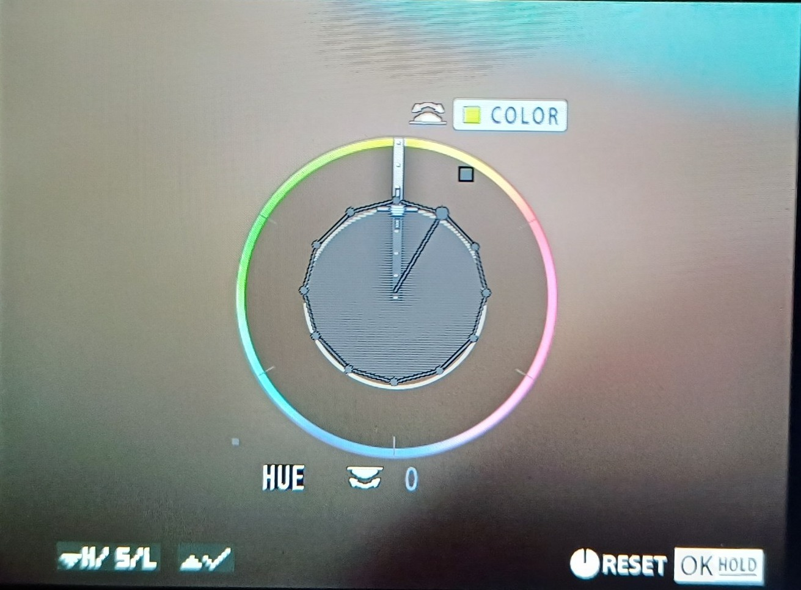 | 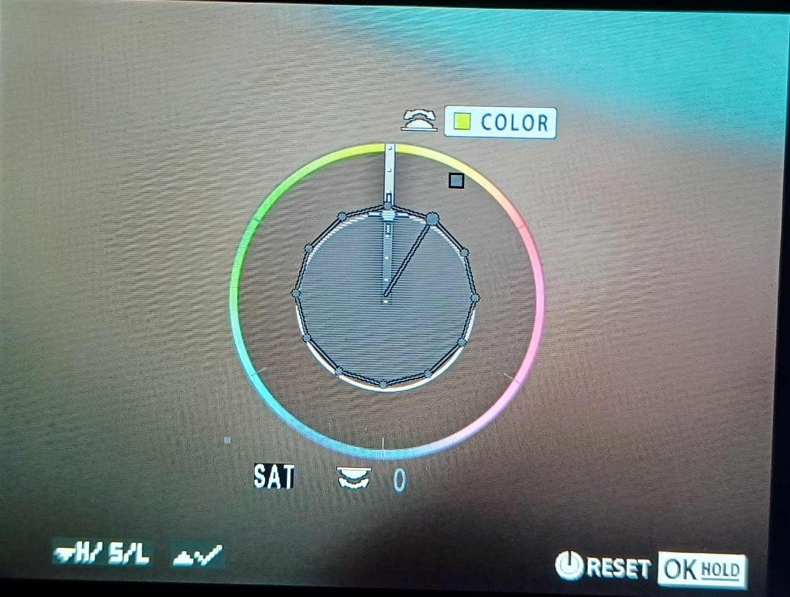 | 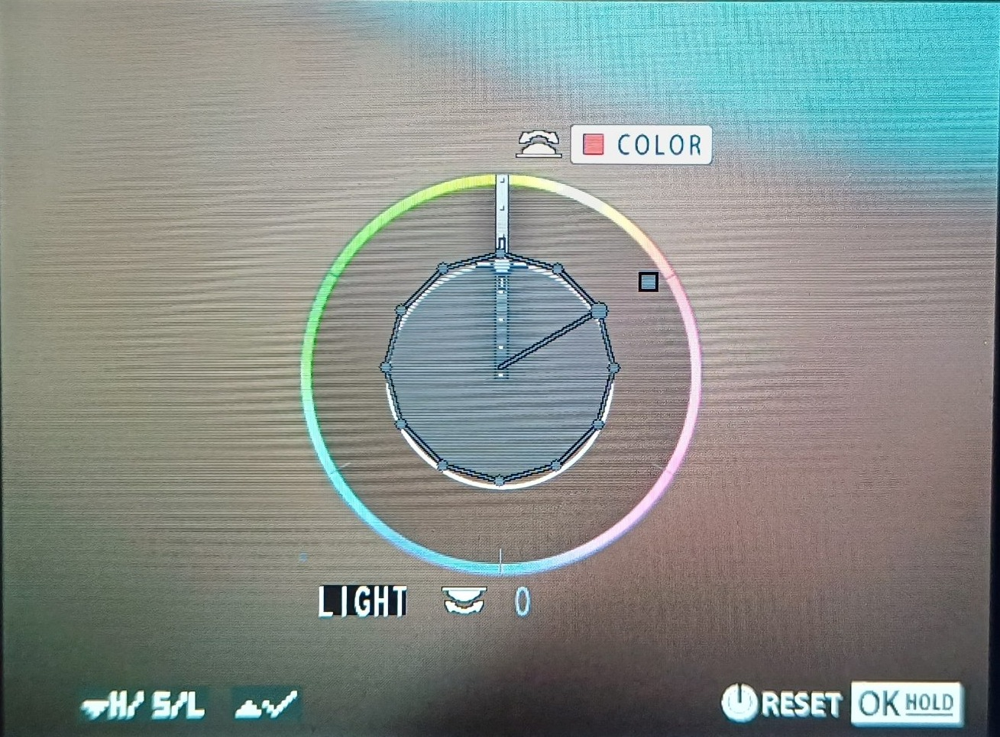 |

*Photos of the camera screen by Meghnus, CC BY 4.0.*

- **UP** selects / marks a sector (several at once), **DOWN** changes the axis (H, S, L), the **front dial**
  moves between sectors, the **rear dial** changes the value, **hold OK** resets all sectors.
- S -7 turns a colour fully grey (pale tones included); H ±7 shifts it by about one sector.
- The recipe is applied to JPEG and live view, is kept after power-off, and does not leak into P / A / S / M.
- Turning the dial to ART shows **COLOR WHEEL** with **RECIPE ON** or **EMPTY** in the mode guide.

Full key map and example recipes: [Color Wheel guide](docs/GUIDE-COLOR-WHEEL.md).

## What version 94 contains

**Film looks**
- 14 film looks, each with its own colour matrix and tone curve.
- 4 new looks: **Portra 400**, **Kodachrome 64**, **Ektar 100**, **Gold 200**, each with its own colour and
  **its own icon**. They appear in the Picture Mode list, the SCP menu, Live View, and RAW Data Edit
  Custom1/Custom2.
- Contrast, Sharpness, Highlight, Shadow and Gradation really change the picture on looks, including Eterna and
  the new looks. In the SCP menu the Contrast and Sharpness dials work on every look.
- Acros in RAW Data Edit Custom is black and white again.

**Colour editors**
- **Colour wheel** in Color Creator (above), centred in the viewfinder, with white balance settable inside Color Creator.
- Per-sector colour editor: Hue, Saturation and Lightness for 12 colour sectors (Green, Amber, Teal, Cyan,
  Azure, Blue, Magenta, Indigo, Olive, Red, Orange, Yellow). The Sector row shows colour names instead of a dash.
- **Per-look colour editor** (new in 88): in Picture Mode, highlight a colour look and press the right arrow. The
  User Hue page has User Hue (On / Off / Reset), Sector, Hue, Sector Sat and Lightness, and the edit applies to
  that look only. Acros has no such page. Details in [docs/GUIDE-56.md](docs/GUIDE-56.md).
- Looks can be chosen in RAW Data Edit Custom1 and Custom2; each bank has its own Contrast, Sharpness,
  Saturation, Gradation and Sector/Hue/Sat/Light rows (the Sector/Hue/Sat/Light rows work since version 94).
- Every row has its own title and caption (for example "Gradation High Key"; an unchanged row reads
  "Picture Mode", meaning it follows the Picture Mode setting) and a new icon.

**Video**
- The recording limit is raised from 29:59 to 59:50 (the recording library is set to 60 minutes). A single video
  file is still capped at 4 GB (FAT32), so at high bitrates recording can stop before 59:50.

**Stability**
- The Contrast / Gradation code on looks was made safe when the camera processes two images at once
  (related to [issue #4](https://github.com/Meghnus/om10mi-mods/issues/4)).

The guides are [docs/GUIDE-56.md](docs/GUIDE-56.md) (looks and editors) and
[docs/GUIDE-COLOR-WHEEL.md](docs/GUIDE-COLOR-WHEEL.md) (colour wheel).

## Samples

Straight out of camera, no editing: an E-M10 Mark I running the version 56 look pack. Each scene was shot once as RAW; the
looks below are the camera's own conversions of that RAW (RAW Data Edit). The first picture of every sheet is
the stock rendering from the same RAW (**Natural**; the Alley scene was shot in **i-Enhance** and is labelled
that way), taken from the preview JPEG the camera stores inside the RAW file, so the difference between the
stock rendering and each look is easy to see. Metadata has been removed from all pictures, and they are
resized to 1600 px on the long side.

The sample photos are (c) 2026 Meghnus, all rights reserved: viewing only, no reuse.

Looks shown, in order: Natural (camera), Eterna, Nostalgic Neg, Ektar 100, Classic Neg.

| Scene | Sheet | Individual files |
|---|---|---|
| Flowers | 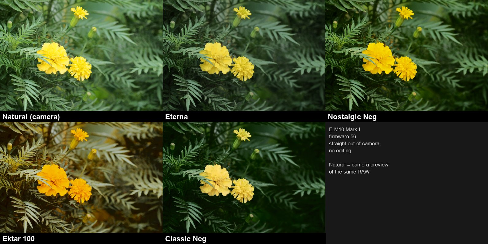 | [natural](docs/samples/flowers_natural.jpg), [eterna](docs/samples/flowers_eterna.jpg), [nostalgic neg](docs/samples/flowers_nostalgic-neg.jpg), [ektar 100](docs/samples/flowers_ektar-100.jpg), [classic neg](docs/samples/flowers_classic-neg.jpg) |
| Tower | 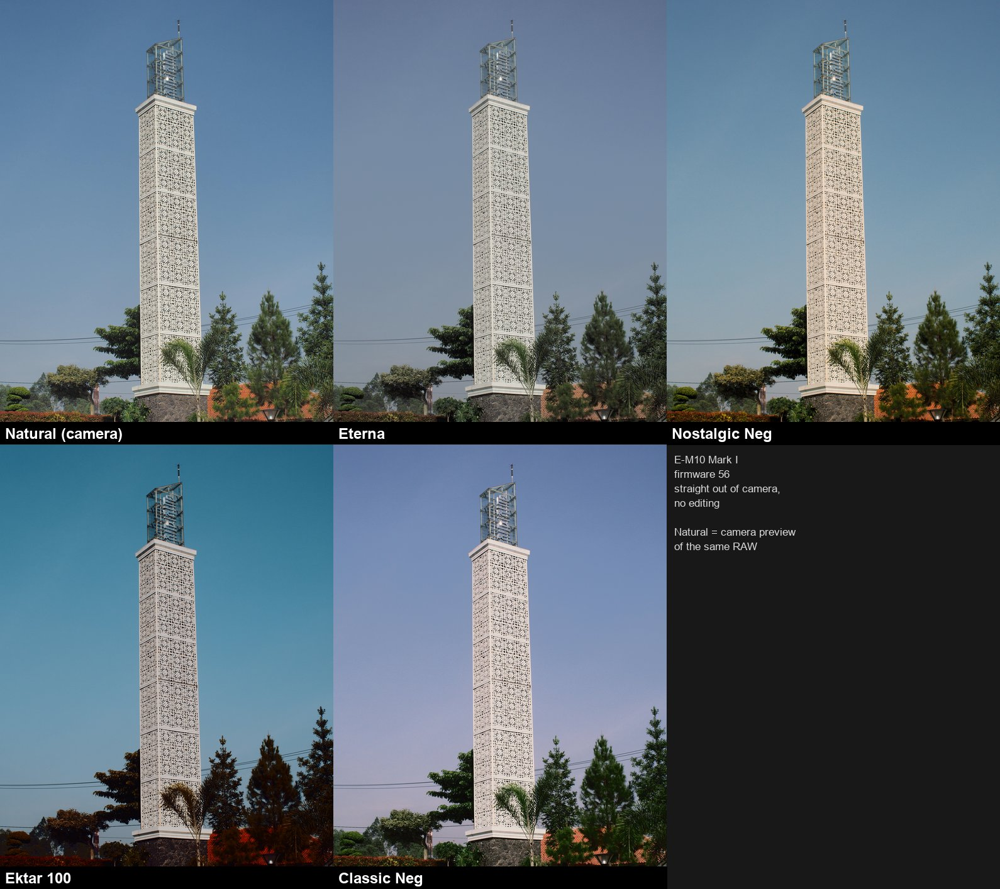 | [natural](docs/samples/tower_natural.jpg), [eterna](docs/samples/tower_eterna.jpg), [nostalgic neg](docs/samples/tower_nostalgic-neg.jpg), [ektar 100](docs/samples/tower_ektar-100.jpg), [classic neg](docs/samples/tower_classic-neg.jpg) |
| Courtyard | 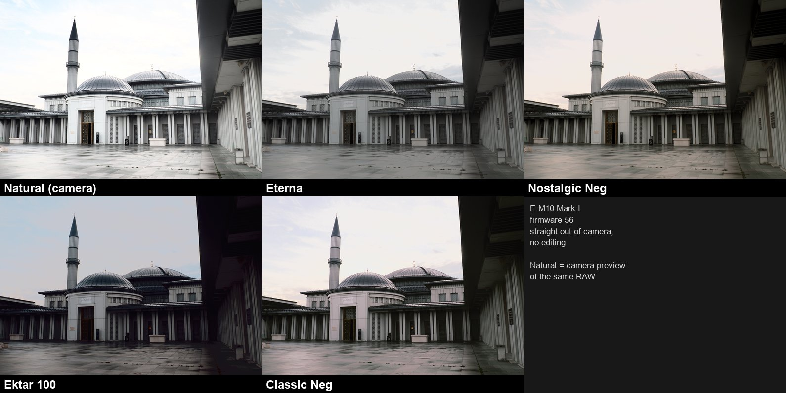 | [natural](docs/samples/mosque_natural.jpg), [eterna](docs/samples/mosque_eterna.jpg), [nostalgic neg](docs/samples/mosque_nostalgic-neg.jpg), [ektar 100](docs/samples/mosque_ektar-100.jpg), [classic neg](docs/samples/mosque_classic-neg.jpg) |
| Wall | 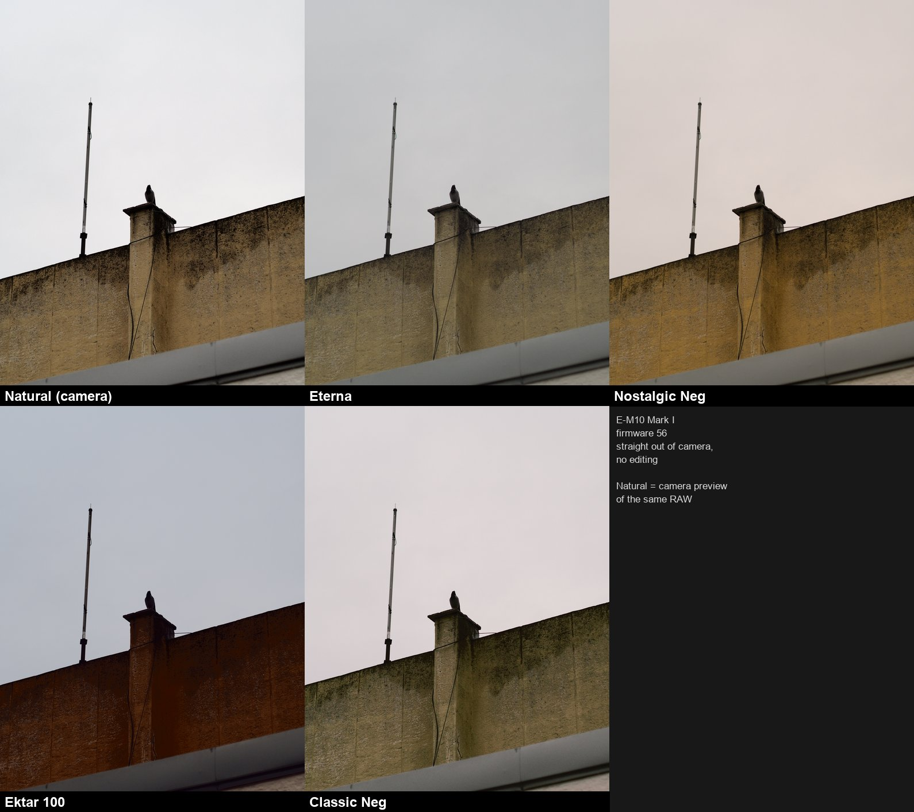 | [natural](docs/samples/wall_natural.jpg), [eterna](docs/samples/wall_eterna.jpg), [nostalgic neg](docs/samples/wall_nostalgic-neg.jpg), [ektar 100](docs/samples/wall_ektar-100.jpg), [classic neg](docs/samples/wall_classic-neg.jpg) |
| Gate | 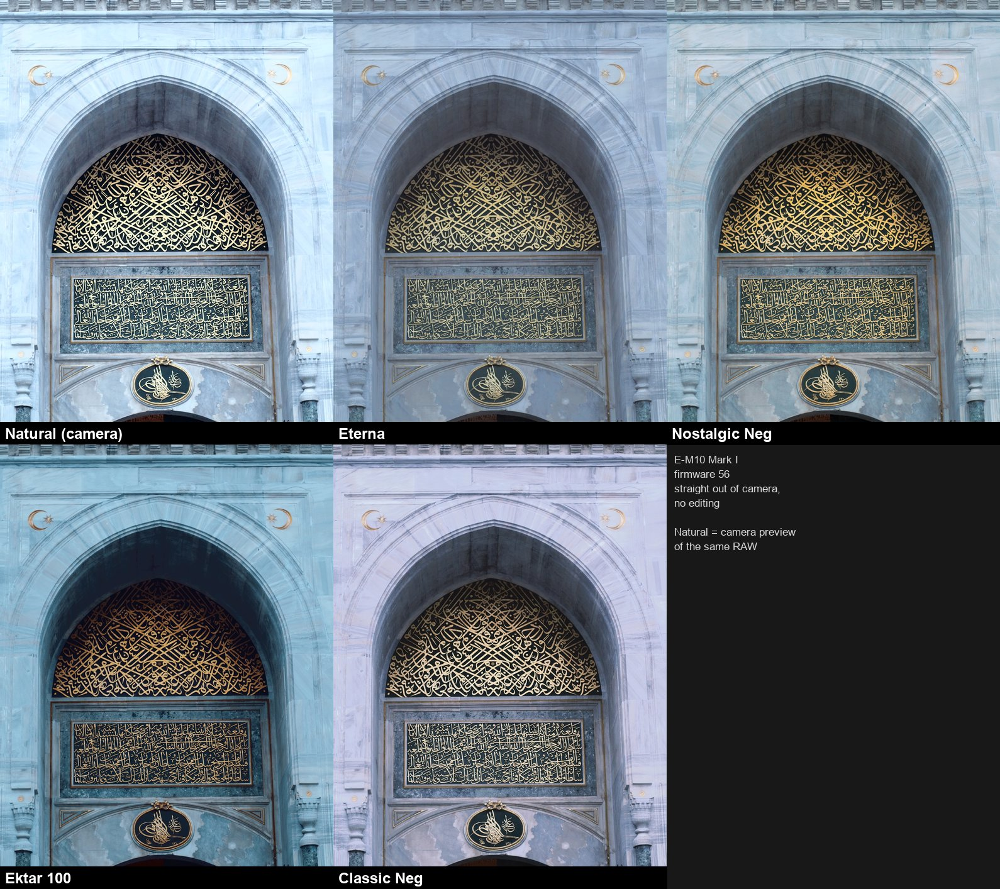 | [natural](docs/samples/gate_natural.jpg), [eterna](docs/samples/gate_eterna.jpg), [nostalgic neg](docs/samples/gate_nostalgic-neg.jpg), [ektar 100](docs/samples/gate_ektar-100.jpg), [classic neg](docs/samples/gate_classic-neg.jpg) |
| Bridge | 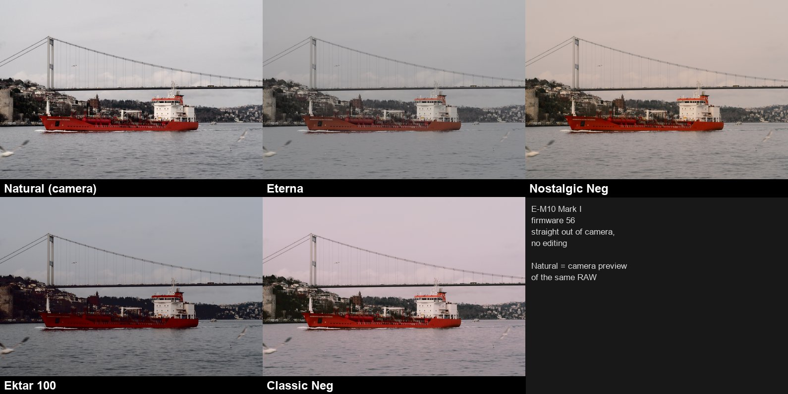 | [natural](docs/samples/bridge_natural.jpg), [eterna](docs/samples/bridge_eterna.jpg), [nostalgic neg](docs/samples/bridge_nostalgic-neg.jpg), [ektar 100](docs/samples/bridge_ektar-100.jpg), [classic neg](docs/samples/bridge_classic-neg.jpg) |
| Minaret | 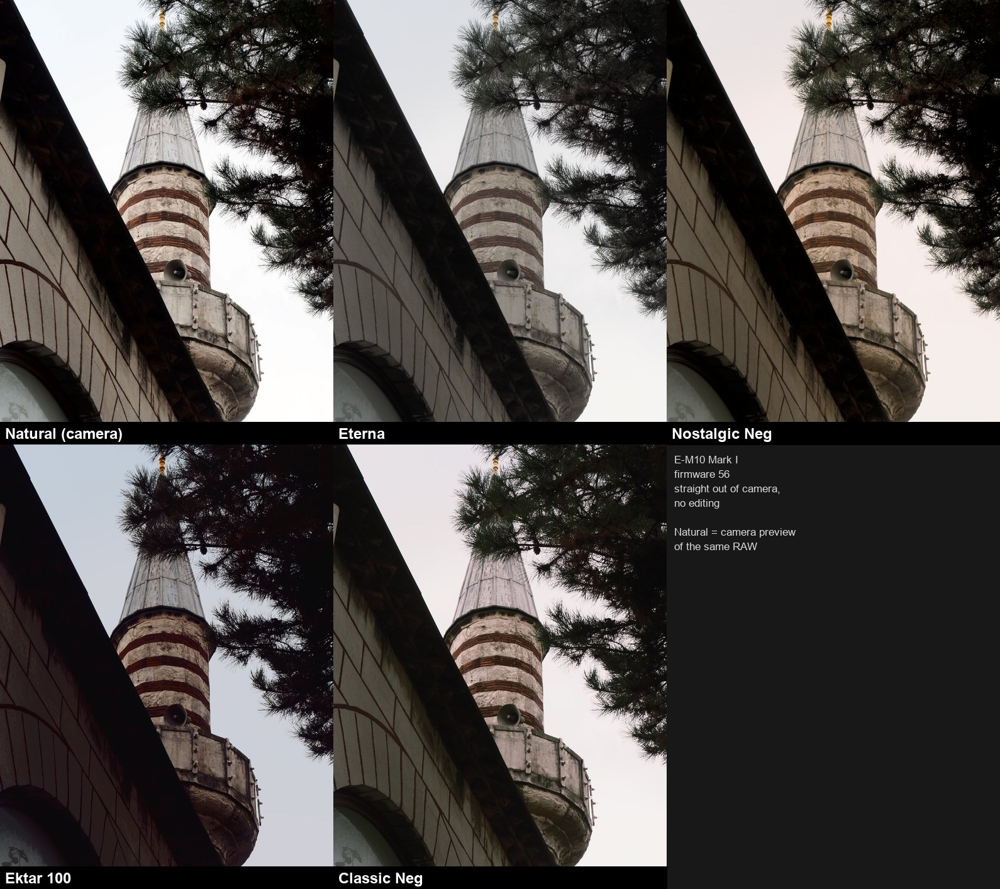 | [natural](docs/samples/minaret_natural.jpg), [eterna](docs/samples/minaret_eterna.jpg), [nostalgic neg](docs/samples/minaret_nostalgic-neg.jpg), [ektar 100](docs/samples/minaret_ektar-100.jpg), [classic neg](docs/samples/minaret_classic-neg.jpg) |
| Street | 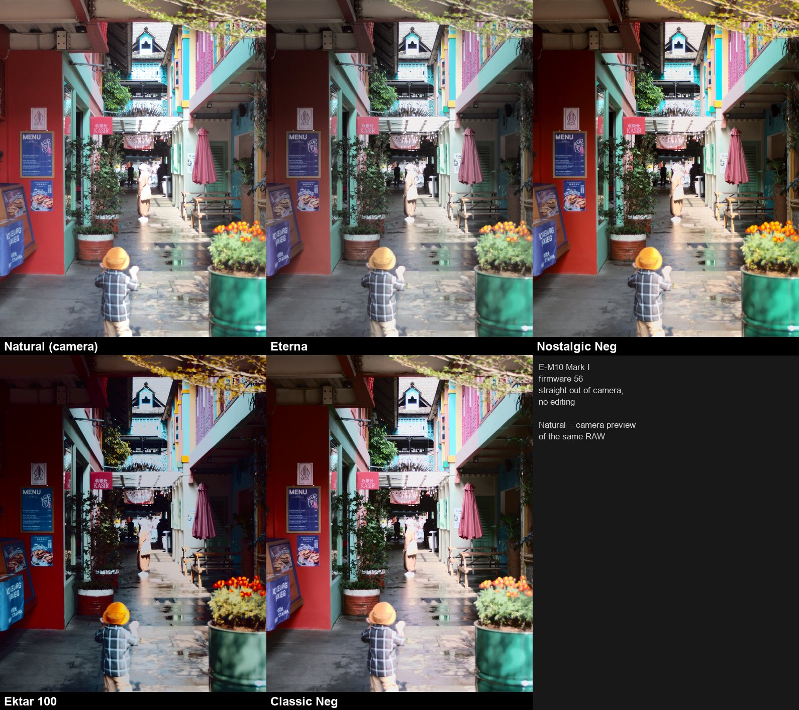 | [natural](docs/samples/street_natural.jpg), [eterna](docs/samples/street_eterna.jpg), [nostalgic neg](docs/samples/street_nostalgic-neg.jpg), [ektar 100](docs/samples/street_ektar-100.jpg), [classic neg](docs/samples/street_classic-neg.jpg) |
| Alley | 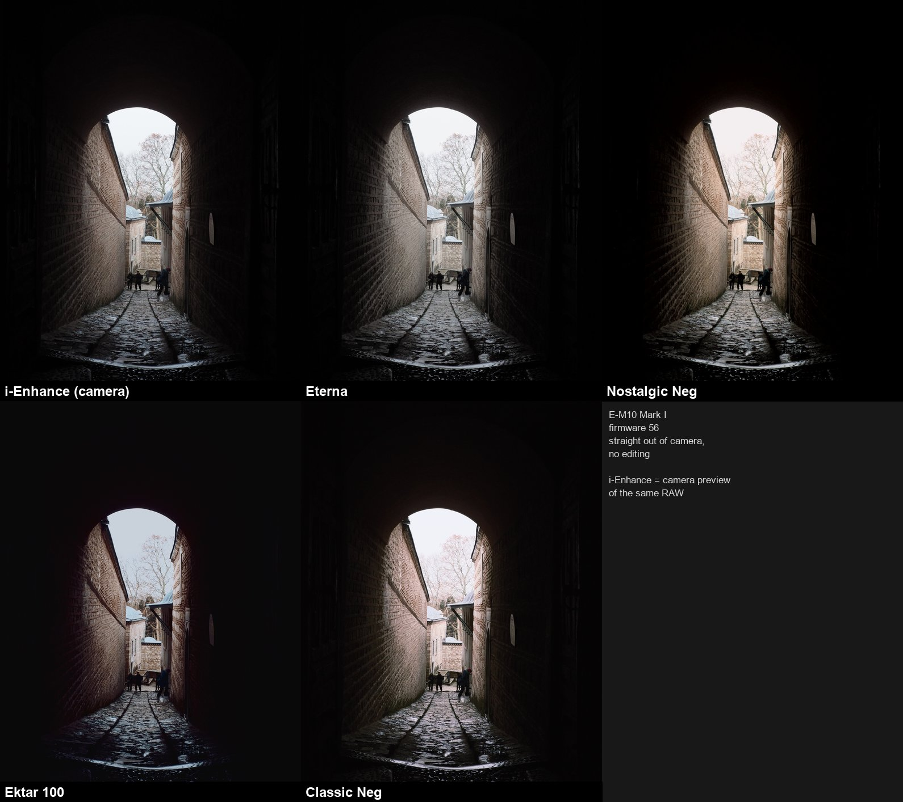 | [i-enhance](docs/samples/alley_i-enhance.jpg), [eterna](docs/samples/alley_eterna.jpg), [nostalgic neg](docs/samples/alley_nostalgic-neg.jpg), [ektar 100](docs/samples/alley_ektar-100.jpg), [classic neg](docs/samples/alley_classic-neg.jpg) |
| Station | 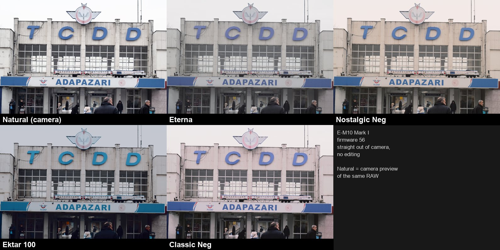 | [natural](docs/samples/station_natural.jpg), [eterna](docs/samples/station_eterna.jpg), [nostalgic neg](docs/samples/station_nostalgic-neg.jpg), [ektar 100](docs/samples/station_ektar-100.jpg), [classic neg](docs/samples/station_classic-neg.jpg) |
| Square | 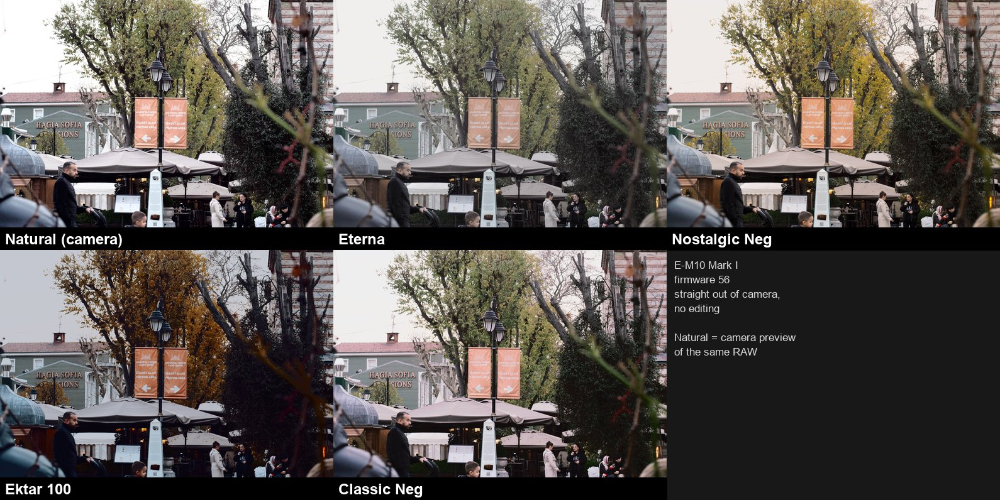 | [natural](docs/samples/square_natural.jpg), [eterna](docs/samples/square_eterna.jpg), [nostalgic neg](docs/samples/square_nostalgic-neg.jpg), [ektar 100](docs/samples/square_ektar-100.jpg), [classic neg](docs/samples/square_classic-neg.jpg) |

These are only a handful of looks; the others (for example Portra 400, Kodachrome 64 and Gold 200) are not
shown yet.

## Warnings

- **No warranty.** Installing custom firmware is always risky; the camera may stop working properly. You accept
  all of the risk (see Apache-2.0 sections 7 and 8, and CC BY-NC-SA 4.0 section 5).
- For the **E-M10 Mark I (code E113) with firmware v1.4** only. Do not install it on any other model. The builder
  refuses files that are not the intended firmware.
- Made and tested on a single camera body belonging to the author. It has never been tried on any other body.
- Update mode (hold OK while switching on) does not run any of the added code, so you can always reinstall the
  official firmware from `out/RESTORE`. Have that file ready, and a full battery, before you start.
- The licence that the OM Digital Solutions server attaches to the download (shown by the builder; you must
  accept it before anything is downloaded) prohibits, among other things, modifying or reverse engineering the
  software. Building and installing this file is your own decision and responsibility. Read that licence.
- Do not share the built BIN file or the official firmware; this repository deliberately includes neither.

## Known changes and limitations

- **The ART dial position is now the colour wheel.** The stock art filters are no longer reached by the dial.
  To use an art filter, set the dial to P / A / S / M and choose it through **Picture Mode in the shooting
  menu**.
- **Fn2 (multi-function) is one camera-wide setting**, as on a stock camera: hold Fn2 and turn a dial to pick
  the function. Whatever you picked last stays selected in every mode, including ART, so you can switch to
  Highlight & Shadow and back to Color Creator without losing the wheel recipe.
- The ART mode guide still shows the **P** icon next to the COLOR WHEEL text.
- **RAW files:** the look's colour matrix is also written into the makernote ColorMatrix tag (0x0200). Adobe
  software ignores that tag; tools that honour it (for example `dcraw -w`) will use it.
- **Lightroom shows a colour temperature about 250-300 K lower than the camera.** This is stock behaviour on
  the E-M10 (Lightroom re-derives Kelvin through Adobe's profile); this project does not change the
  white-balance data ([issue #3](https://github.com/Meghnus/om10mi-mods/issues/3)).
- **Version 94:** the help text of one button-function option reads "Sector Sat". The colour wheel is centred in
  the EVF only approximately. Hiding looks (look pack builder) is not available.
- **Look pack builder:** optional, approximate (a colour matrix plus tone curves per look, not the LUT itself), and
  every look must keep the base picture mode of its slot. Hand-made packs are tested on the PC and on the author's
  camera for the cases listed in [looktool/README.md](looktool/README.md); other combinations are less tried.

## Version history

Only milestones that were tried on a camera. The builder produces **only version 94**, which contains all
earlier content; older versions are not offered.

**About the version numbers.** A version number is not a major/minor release number and does not measure how
many features were added. It counts test builds: every image that was built, audited and staged for a camera
trial gets the next number, including small fixes and builds that were rejected. A jump from 56 to 94
therefore means many rounds of fixing and testing (mostly on the colour wheel), not a long list of new features.
Please mention the version number when you report an issue.

| Version | Main content | Test status |
|---|---|---|
| 37 | 14 film looks with their own colour matrix and tone curve | Audited; installed on the owner's camera and the base of every later version |
| 40 | 37 + video recording limit raised to about 60 minutes (59:50) | Installed and used on the camera; recording beyond 30 minutes not yet confirmed |
| 46 | Per-sector colour editor (Hue/Saturation/Lightness) | Field test passed: the editor shows and the effect is visible in photos |
| 48 | Per-look colour editor on the Custom page (moved to each look's own page in 88) | Field test passed |
| 51 | Looks selectable in RAW Data Edit Custom1/Custom2 | Field test passed |
| 56 | 51 + 4 new looks (Portra 400, Kodachrome 64, Ektar 100, Gold 200); per-bank Contrast/Sharpness/Saturation/Gradation and Sector/Hue/Sat/Light in RAW Data Edit; Highlight/Shadow/Contrast/Gradation work on looks; colour-named Sector; row titles; new icons; SCP Contrast/Sharpness on looks; Acros fix | Two independent audits passed; owner's field test: works well |
| 57-86 | Colour wheel: internal test builds | Tested on the owner's camera; not released |
| 87 | 56 + colour wheel in Color Creator (12 sectors, H/S/L), on-screen hint, COLOR WHEEL mode guide, own icons for the 4 new looks, Contrast/Gradation stability fix | Tested by running the camera code in a PC emulator, independently reviewed, then field-tested on the owner's camera |
| 88 | 87 + per-look colour editor on each colour look's right-arrow page (User Hue On/Off/Reset, Sector, Hue, Sector Sat, Lightness); User Hue Reset moved there from the Custom page | Field-tested on the owner's camera; known RAW Data Edit bank-row problem (fixed in 94) |
| **94** | 88 + RAW Data Edit bank rows fixed, colour wheel centred in the EVF, WB in Color Creator, SCP C/S/Sat sync, per-look C/S/Sat rows; optional look pack builder (`looktool/`) and web pages (`docs/lut/`) | The code was field-tested on the owner's camera (as the base of look-pack builds); the plain version 94 image is the same code without the look-pack layer. **This is what the builder makes.** |

## Look pack builder and LUT import (optional, new in version 94)

Turn a `.cube` or Adobe Creative Profile `.xmp` into an approximate camera look, put it into a look slot of your choice,
rename looks and change the Picture Mode order. The camera has no 3D-LUT stage, so a look is a colour matrix plus tone
curves fitted to your LUT: close for gentle film-style LUTs, weaker for extreme ones. Two steps:

1. In the browser (nothing is uploaded): the [look list manager](https://meghnus.github.io/om10mi-mods/lut/panel.html) ranks
   the base picture modes against your LUT, fits, previews and exports a pack file
   (the single-LUT page is [here](https://meghnus.github.io/om10mi-mods/lut/)).
2. On your PC: `looktool/om10mi_look.py` applies the pack to the version 94 image you built from your own official firmware.

Details, limits and licences: [looktool/README.md](looktool/README.md) and [docs/lut/README.md](docs/lut/README.md). Three CC0
example LUTs and an example pack are in `looktool/examples/`. Hiding looks is not available.

## Other cameras and related projects

Many people asked for ports to other OM / Olympus cameras. This repository is for the E-M10 Mark I only (never flash an image
built for another model). For other bodies use the analysis tools published separately:
**[oly-truepic-harness](https://github.com/Meghnus/oly-truepic-harness)** (the firmware test lab behind these mods) and the
look pack tools above. **[fenykl](https://github.com/atx/fenykl)** (MIT, atx) is a mod loader with C plugins for the E-M10 Mark II;
it is credited where its ideas are used. No fenykl code is used in this repository yet.

## Credits

No code or LUT files from the projects below are included; only fitted numbers (matrices and curves) that we
computed ourselves, or facts and ideas. Licences and details are in [NOTICE](NOTICE).

- **cakelesscoder/caduceus-ep7** (Apache-2.0): firmware mods for the E-P7; design reference for the look editor,
  HSL handling and the ends of the tone curve, and the inspiration for the colour-wheel idea.
  https://github.com/cakelesscoder/caduceus-ep7
- **atx/fenykl** (MIT): mod loader for the E-M10 Mark II; ideas credited where used, no code used yet. https://github.com/atx/fenykl
- **fishcu/oly_fw_analysis** (Apache-2.0): research notes on Olympus / OM System firmware (PEN-F in most depth):
  the image-processing job map and grain notes. https://github.com/fishcu/oly_fw_analysis
- **cmdada/em10-fw** (GPL-3.0, notes on the same E-M10 Mark I v1.4 firmware): facts on the multi-core and cache
  layout, the watchdog and the fault handling, used in the freeze analysis. Read only, no code copied.
  https://github.com/cmdada/em10-fw
- **TingfengLuo/Camera-Profile-for-Fujifilm-Film-Simulation** and **abpy/FujifilmCameraProfiles**: Fujifilm
  film-simulation profiles used as colour targets for the Fuji-style looks.
- **spektrafilm** (Andrea Volpato) through the LUTs bundled with **RapidRAW** (CyberTimon): reference for
  Portra 400, Ektar 100 and Gold 200 (LUTs CC BY-SA 4.0, with a request not to resell them).
- **HaldCLUT / RawTherapee Film Simulation Collection** (Pat David, Pavlov Dmitry, Michael Ezra; CC BY-SA 4.0):
  reference for Kodachrome 64.
- **Spectral Film LUT** (Jan Lohse, MIT): a second film model used as a cross-check.
- **Fuji X Weekly**: the list of most popular recipes, used to choose which looks to add.
- **CUBE-to-XMP** (MIT): reference for reading LUT tables stored in XMP files.
- **Jonathan Schwarzenböck (lightsnowdev.com)**: documented flashing the E-M10 from a memory card.
- An anonymous community modder who published the E-M5 Mark II video-limit patch (the idea for the recording
  limit).
- **GNU binutils** (MN10300 opcodes) and **Linux arch/mn10300**: CPU documentation for reading the camera code.
- **Imaging Resource**, **Adobe Community** and **The Lightroom Queen**: references for the AF and Lightroom
  white-balance notes.

Olympus, OM System, OM-D and the film names (Portra, Kodachrome, Ektar, Gold, Fujifilm and others) are
trademarks of their owners and are used only to identify things.

## Licences

| Part | Licence |
|---|---|
| Code `om10mi.py`, `looktool/`, `docs/lut/` and documentation (README, INSTALL, guides) | Apache License 2.0, see [LICENSE](LICENSE) |
| Data: `patch/*.json`, `looktool/web/model-cm-v2-web1.json`, `docs/lut/model-cm-v2-web1.json` and any other look data | Creative Commons BY-NC-SA 4.0 (attribution, non-commercial, share-alike), see [LICENSE-DATA](LICENSE-DATA) |
| Colour-wheel photos in `docs/img` | CC BY 4.0, by Meghnus |
| Example LUTs `looktool/examples/*.cube` and `docs/lut/samples/*.cube` (synthetic, made by us) | CC0 1.0 |
| Sample pictures in `docs/samples` | (c) 2026 Meghnus. All rights reserved: viewing only, no reuse. See [docs/samples/README.md](docs/samples/README.md) |

The look data consists of numbers fitted to the references credited above and in [NOTICE](NOTICE), which is why
it carries a non-commercial licence with attribution to all of them. None of the licences covers the OM Digital
Solutions firmware. The method used to develop and test the firmware is in
[docs/DEVELOPMENT.md](docs/DEVELOPMENT.md).
