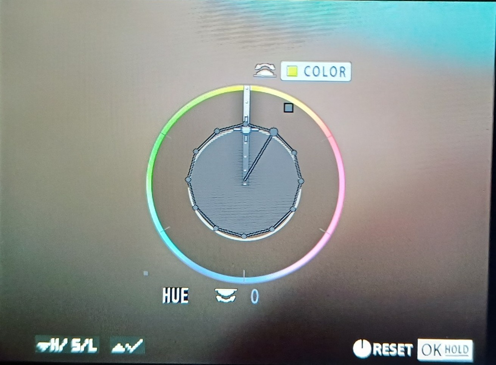
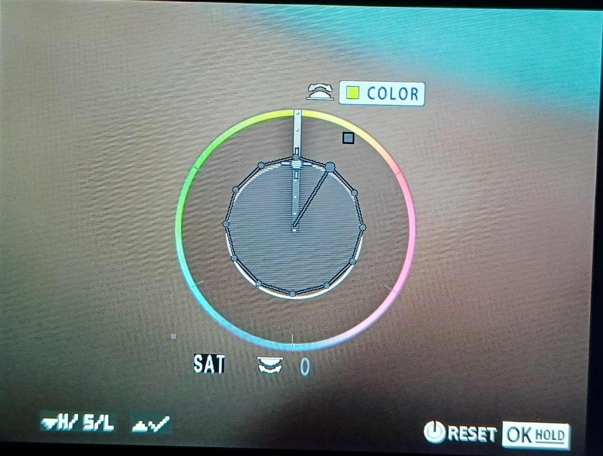
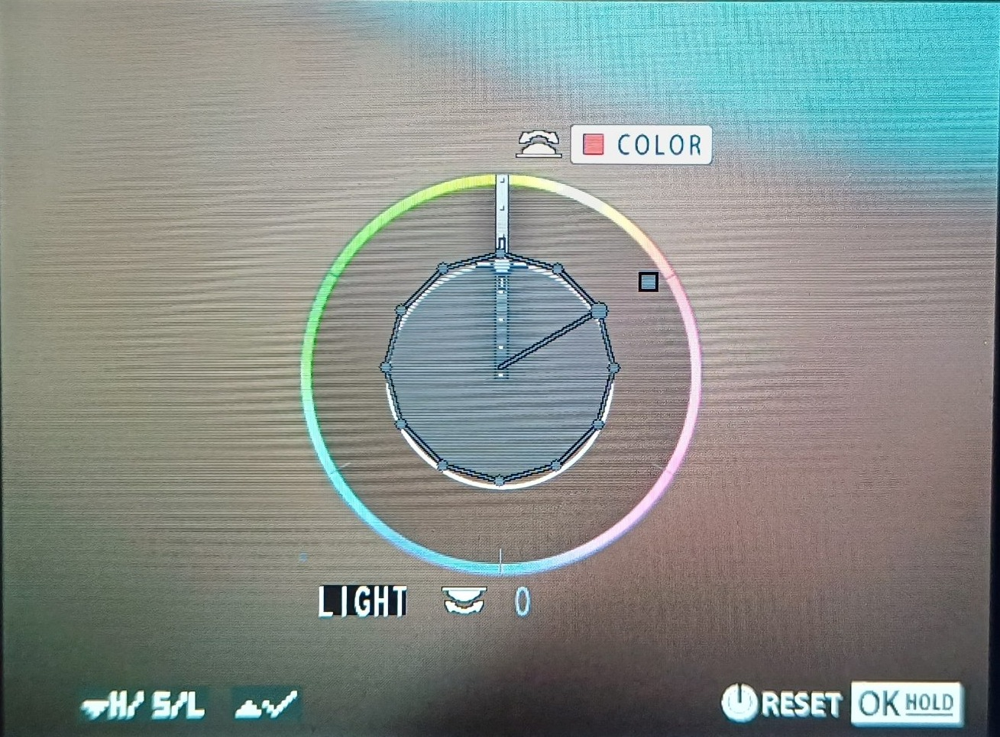

# Color Wheel user guide

Sections 1 to 7 describe behaviour confirmed on a camera; the example recipes in section 8 are starting points.

## 1. What it is

A PEN-F-style colour wheel for the E-M10 Mark I, inside Color Creator at the **ART** dial position.

- 12 colour sectors around the wheel.
- Each sector has three axes: **H** (hue), **S** (saturation), **L** (lightness), each from -7 to +7.
- The recipe is applied to JPEG files and to live view, and the live view matches the JPEG.
- The recipe is saved and survives power-off.
- P / A / S / M are not affected. Colours there stay normal.

| HUE axis | SAT axis | LIGHT axis |
|---|---|---|
|  |  |  |

*The wheel on an E-M10 Mark I (photos of the camera screen). The axis label (HUE / SAT / LIGHT) and value sit under the wheel; the hint `▼ H/S/L ▲ ✓` is at the bottom-left; the COLOR tag shows the selected sector's colour.*

## 2. Opening the wheel

1. Turn the mode dial to **ART** and open **Color Creator** through the Fn2 (multi-function) button. The multi-function choice is one camera-wide setting, as on a stock camera: hold Fn2 and turn a dial to pick the function. Whatever you picked last stays selected in every mode. This is handy: in ART you can switch Fn2 to Highlight & Shadow, adjust the tone, then switch back to Color Creator; your wheel recipe is kept.
2. To leave, use the normal camera exit (for example half-press the shutter). The on-screen hint disappears.

## 3. Controls

| Key | Function |
|---|---|
| UP | Select / mark a sector. You can mark several sectors and edit them together. |
| DOWN | Change the axis: H -> S -> L. |
| Front dial | Move the cursor between sectors. |
| Rear dial | Change the value, -7 to +7, of the current axis. |
| OK (hold) | Reset all sectors. |
| INFO / Delete | Normal camera functions (no wheel function). |

The hint at the bottom-left reads **`▼ H/S/L  ▲ ✓`**: DOWN changes the axis, UP selects.
The camera's own readout shows the current axis and value (for example `LIGHT = 0`).

## 4. What the values mean

- **S -7**: full grey for that hue, pale tones included. S +7 is strongly saturated.
- **H ±7**: shifts the hue by about one sector (about 30 degrees).
- **L ±7**: about ±20 L* (lighter or darker).

A sector you never touch keeps its normal colour. In a sector you do edit, each axis sets its own value.

## 5. Mode guide

Turn the mode dial to ART. The guide text reads **COLOR WHEEL** with **RECIPE ON** (some sector is non-zero) or **EMPTY** (all zero).
The icon still shows the **P** icon. This is known and accepted.

## 6. The stock ART filters

The ART dial position is now the wheel, so the dial no longer reaches the stock art filters.
To use them, set the mode dial to P / A / S / M and choose the art filter through **Picture Mode in the shooting menu**.

## 7. Notes and limits

1. **RECIPE ON** means at least one sector value is not zero.
2. After a RAW Data Edit, press a wheel key or re-enter ART before shooting with the recipe. The guide can read ON while the recipe is still waiting for a key.
3. INFO and Delete work normally. Menu and playback are normal.
4. The P icon in the ART guide is cosmetic.
5. Very dark and very pale pixels in a single edited sector can spread a little into neighbouring colours.

## 8. Example recipes

All edits are per sector. Mark sectors with UP, choose the axis with DOWN, set the value with the dial.

1. **Monochrome**: S -7 in all 12 sectors.
2. **Teal and orange**: orange/yellow sectors: S +3, H -1 (warmer). Blue/cyan sectors: S +3, H +1 (towards teal). Leave the others at 0.
3. **Muted greens**: the green sectors: S -4, L -1.
4. **Skin warmth**: the red/orange sectors: S +1, L +1. Keep it small.

The values in 2 to 4 are starting points, not tested recipes. Adjust by eye.

## 9. Recovery and safety

- Never flash an image from another camera model.
- If the camera misbehaves: turn it off (remove the battery if it is frozen). Hold OK while turning it on with the mode dial on P (update mode). Flash the **official** firmware (OM System update tool) or the previous release.
- This mod does not touch the camera except through the normal firmware update.

## Version 94 notes

- White balance can be set inside Color Creator. Entering Color Creator resets WB to Auto once, like the stock camera.
- In the viewfinder the wheel is centred (approximately, within a few pixels); the LCD is unchanged.
